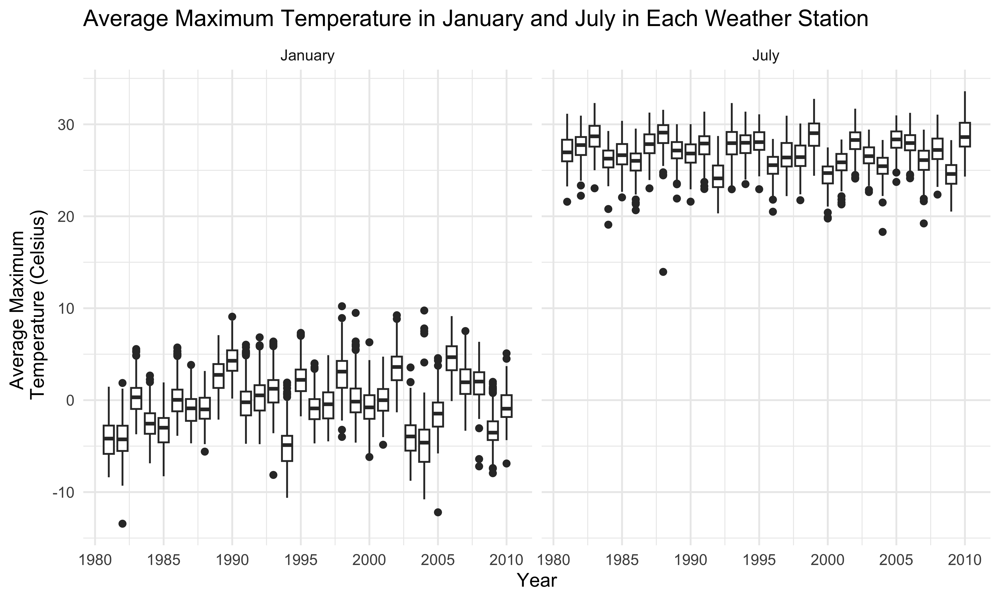
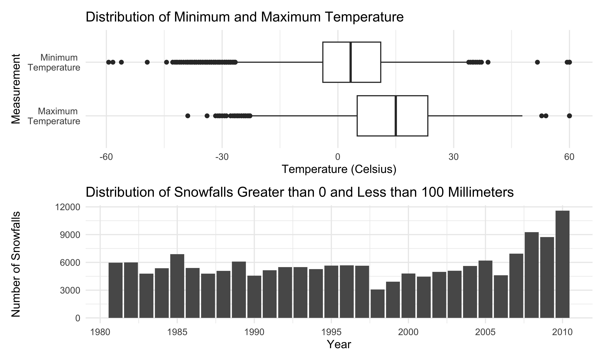
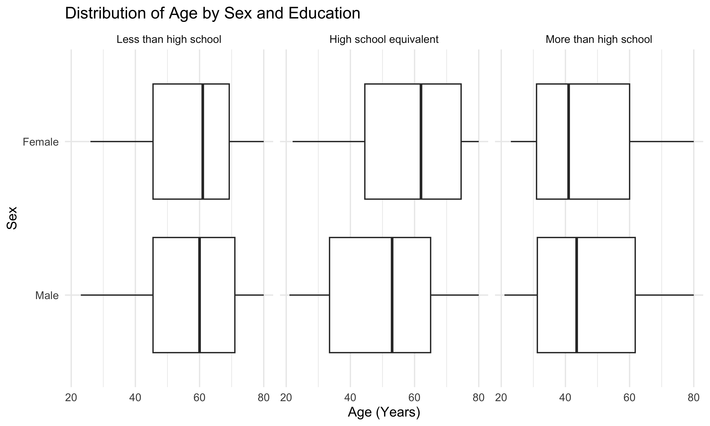
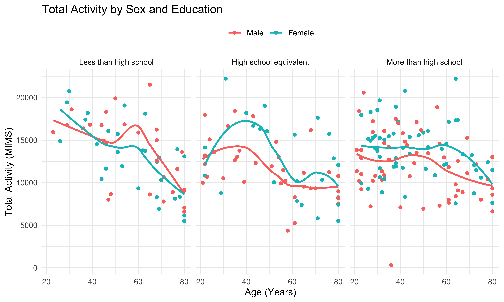
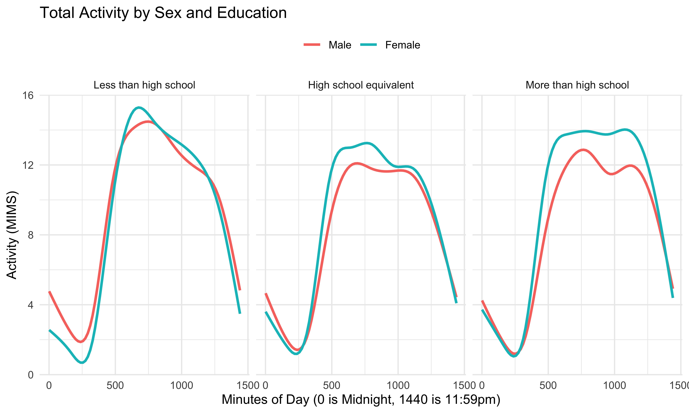

Data Science I (P8105), Homework 3
================
Max Hyman (mjh2289),
2026-10-12

##### Load packages

``` r
library(tidyverse)
library(p8105.datasets)
library(patchwork)
```

##### Set global plotting options

``` r
knitr::opts_chunk$set(  
  echo = FALSE,   
  collapse = TRUE,   
  fig.width = 8,       
  fig.asp = 0.6,       
  out.width = "90%",   
  fig.retina = 2,     
  dpi = 300
  ) 
```

# Problem 1

##### The goal is to do some exploration of this dataset. To that end, write a short description of the dataset, noting the size and structure of the data, describing some key variables, and indicating the extent to which missing data is an issue.

The NY NOAA dataset include weather data from all New York state weather
stations from January 1, 1981 through December 31, 2020, from the
National Oceanic and Atmospheric Association. The dataset include
2595176 daily weather observations and 7 variables. Two of the variables
serve as identifiers, including a character identifier for the weather
station and a date of the daily weather observation at that station.
Weather measurements include precipitation (tenths of millimeters),
snowfall (millimeters), snow depth (millimeters), maximum temperature
(tenths of degrees Celsius), and minimum temperature (tenths of degrees
Celsius). While the dataset is tidy in structure, there is extensive
missingness among the measurement variables, as each weather station may
not had collected all five measurements. Of the 2595176 observations,
missingness occurred for 145838 precipitation measurements, 381221
snowfall measurements, 591786 snow depth measurements, 1134358 maximum
temperature measurements, and 1134420 minimum temperature measurements.

##### Do some data cleaning. Create separate variables for year, month, and day. Ensure observations for temperature, precipitation, and snowfall are given in reasonable units. For snowfall, what are the most commonly observed values? Why?

    ## # A tibble: 282 × 2
    ##     snow   count
    ##    <int>   <int>
    ##  1     0 2008508
    ##  2    NA  308943
    ##  3    25   31022
    ##  4    13   23095
    ##  5    51   18274
    ##  6    76   10173
    ##  7     8    9962
    ##  8     5    9748
    ##  9    38    9197
    ## 10     3    8790
    ## # ℹ 272 more rows

Data cleaning first involved removing any observations in which all five
weather measurements were missing. Next, I generated the year, month,
and day for of each measurement date. Finally, the minimum and maximum
temperatures were stored as character type, which I converted to numeric
type. Furthermore, the minimum and maximum temperatures were stored in
unintuitive units, tenths of degrees Celsius, such that I divided by ten
so that the unit would then be degrees Celsius; I did the same for
precipitation which was stored as tenths of millimeters.

The most commonly observed values for snowflake, other than missing,
were 0 millimeters (n=2008508), 25 millimeters (n=31022), and 13
millimeters (n=23095). Those measurements correspond to approximately 0,
1, and 0.5 inches, respectively, which makes sense as to why they are
the most commonly observed.

##### Make a two-panel plot showing the average max temperature in January and in July in each station across years. Is there any observable / interpretable structure? Any outliers?



This boxplot illustrates the distribution of average maximum temperature
in January or July for each weather station across years. There are a
few interesting observations. First, the median average temperature is
more variable over time in January than July. That difference in
variability could reflect how the average maximum temperature for
weather stations downstate versus upstate New York are more aligned in
July than January. Second, the distribution of average temperature in
January appears by inspection to be shifting to warmer temperatures over
time. The distribution in July does not appear to be changing. Finally,
whereas the outliers in July are exclusively lower-tail outliers, the
outliers in January are lower- and upper-tail outliers. Therefore, an
unusually cold day in July may be considered an outlier, while an
unusually cold or warm day in January may be considered an outlier.

##### Make a two-panel plot showing (i) tmax vs tmin for the full dataset (note that a scatterplot may not be the best option); and (ii) showing the distribution of snowfall values greater than 0 and less than 100 separately by year.



This two-panel plot illustrates the (1) distribution of minimum and
maximum temperature across the entire dataset, and (2) distribution of
snowfalls greater than 0 and less than 100 millimeters. For the
temperature boxplot, as expected, the distribution of maximum
temperature is greater than minimum temperature, with lower- and
upper-tail outliers for both. For the snowfalls histogram, the number of
snowfalls greater than 0 and less than 100 millimeters was stable around
5000 per year from 1980 to 2006, but since 2006 has increased rapidly,
exceeding 10000 in 2010.

# Problem 2

##### Load, tidy, merge, and otherwise organize the data sets. Your final dataset should include all originally observed variables; exclude participants less than 21 years of age, and those with missing demographic data; and encode data with reasonable variable classes (i.e. not numeric, and using factors with the ordering of tables and plots in mind).

ADD DESCRIPTION

##### Produce a reader-friendly table for the number of men and women in each education category, and create a visualization of the age distributions for men and women in each education category. Comment on these items.

| sex    | education              | count |
|:-------|:-----------------------|------:|
| Male   | Less than high school  |    27 |
| Male   | High school equivalent |    35 |
| Male   | More than high school  |    56 |
| Female | Less than high school  |    28 |
| Female | High school equivalent |    23 |
| Female | More than high school  |    59 |



ADD DESCRIPTION

##### Traditional analyses of accelerometer data focus on the total activity over the day. Using your tidied dataset, aggregate across minutes to create a total activity variable for each participant. Plot these total activities (y-axis) against age (x-axis); your plot should compare men to women and have separate panels for each education level. Include a trend line or a smooth to illustrate differences. Comment on your plot.



ADD DESCRIPTION

##### Accelerometer data allows the inspection activity over the course of the day. Make a three-panel plot that shows the 24-hour activity time courses for each education level and use color to indicate sex. Describe in words any patterns or conclusions you can make based on this graph; including smooth trends may help identify differences.



Add description. Fix x-axis

# Problem 3

##### Files contain 1% of all rides with a total duration less than 4 hours in each of four months. Import, clean, and tidy these data, and describe the resulting dataset.

##### Produce a reader-friendly table showing the total number of rides in each combination of year and month separating casual riders and Citi Bike members. Comment on these results.

##### Make a table showing the 5 most popular starting stations for July 2024; include the number of rides originating from these stations.

##### Make a plot to investigate the effects of day of the week, month, and year on median ride duration. This plot can include one or more panels, but should facilitate comparison across all variables of interest. Comment on your observations from this plot.

There were relatively few electric Citi Bikes in 2020, but many more are
available now. For data in 2024, make a figure that shows the impact of
month, membership status, and bike type on the distribution of ride
duration. Comment on your results.
